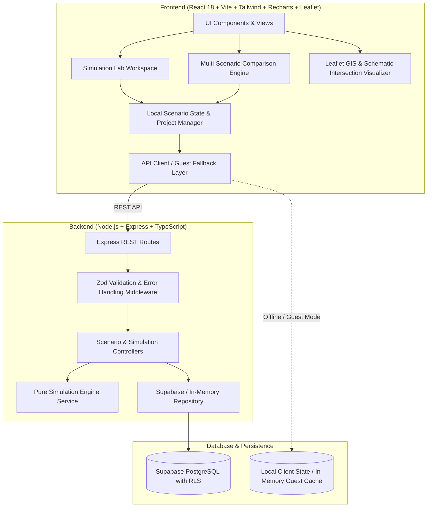

# WhatIf City Architecture

## 1. System Architecture Overview

WhatIf City is designed with clean architectural boundaries, separating pure numerical simulation logic from API transport and user presentation.



---

## 2. Directory Hierarchy

```text
whatif-city/
  frontend/
    src/
      components/           # Accessible, reusable atomic UI elements
        common/             # Navbar, Footer, Modal, Tooltip, Alert, StatCard
        ui/                 # Sliders, Inputs, Badges, Tabs
      layouts/              # MainLayout, AppShell
      pages/                # LandingPage, ScenarioLibraryPage, SimulationLabPage, ComparisonPage, ProjectsPage, MethodologyPage
      features/
        scenarios/          # ScenarioCard, ScenarioFilters, TemplateModal
        simulation/         # ParameterForm, LiveControls, QueueVisualizer, AssumptionsDrawer
        comparison/         # ScenarioDiffTable, KPIRadar, TradeOffMatrix, ObjectiveSelector
        maps/               # LeafletMap, SchematicIntersection, GeoMarkers
        reports/            # ReportView, PrintStyles, CSVExporter
      hooks/                # useSimulation, useComparison, useScenarios, useTheme
      services/             # api.ts, storage.ts, simulationClient.ts
      types/                # Shared TypeScript simulation interfaces
      utils/                # formatting.ts, calculations.ts, exportUtils.ts
      App.tsx
      main.tsx
  backend/
    src/
      config/               # env.ts, constants.ts
      routes/               # scenarioRoutes.ts, simulationRoutes.ts, projectRoutes.ts
      controllers/          # scenarioController.ts, simulationController.ts, projectController.ts
      services/             # simulationEngine.ts, scenarioService.ts, supabaseClient.ts
      models/               # types and domain models
      middleware/           # errorHandler.ts, validate.ts, rateLimiter.ts
      validators/           # scenarioValidator.ts, simulationValidator.ts
      simulations/          # modular simulation models (trafficQueue.ts, pedCross.ts, parking.ts, transit.ts)
      utils/                # prng.ts, math.ts
      app.ts
      server.ts
    tests/
      simulationEngine.test.ts
      validators.test.ts
      api.test.ts
  supabase/
    migrations/
      001_initial_schema.sql
    seed.sql
  docs/
    simulation-methodology.md
    architecture.md
  package.json
  README.md
  .gitignore
```

---

## 3. Core Principles

### 3.1 Pure Decoupled Simulation Engine
The simulation engine (`backend/src/simulations/trafficQueue.ts` and `frontend/src/features/simulation/engine/`) is implemented as pure functions without side-effects or HTTP dependencies:
```typescript
function simulateTrafficQueue(params: TrafficSimulationParams): SimulationResult
```
- **Determinism:** When given the same parameters and random seed, it returns identical outputs.
- **Client & Server Equivalence:** The logic runs identically on the backend (for persisted runs and batch comparisons) and can also run client-side in offline/guest mode without network round-trips.

### 3.2 Safety & Defensive Validation
Every numerical input passes strict schema validation via **Zod**:
- No division by zero: protected with safe percentage calculus.
- Bounded signal intervals: Green $+$ Yellow $\le$ Cycle.
- Non-negative queue constraints: $Q_t \ge 0$.
- Departures cannot exceed physical road discharge capacity or available queued vehicles.

### 3.3 Zero Paid API Lock-In
- Maps use free OpenStreetMap tiles with attribution.
- If tile servers are unreachable, a clean vector canvas schematic of the intersection is automatically displayed.
- If Supabase environment variables are not supplied, the app seamlessly boots into in-memory/guest mode with full persistence via browser LocalStorage.
